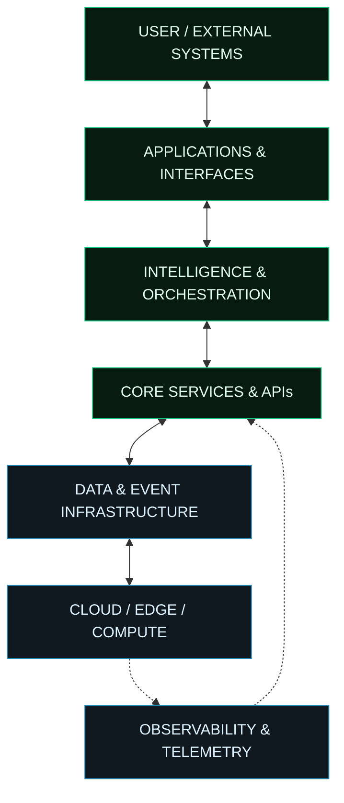

 

<!-- HERO -->

  

# TEMPLE LABS

### FORGE / ADVANCING HUMANITY.

**WE DON'T JUST BUILD SOFTWARE.**
 
**WE EXPLORE WHAT SOFTWARE CAN BECOME.**

 

<a href="#projects">PROJECTS</a> &nbsp; ◈ &nbsp;
<a href="#disciplines">DISCIPLINES</a> &nbsp; ◈ &nbsp;
<a href="#architecture">ARCHITECTURE</a> &nbsp; ◈ &nbsp;
<a href="#research">RESEARCH</a> &nbsp; ◈ &nbsp;
<a href="#connect">CONNECT</a>

---

## ◈ 00 / THE MISSION

Temple Labs is an independent software engineering and technology research laboratory.

We design, engineer and explore intelligent systems, computational infrastructure and digital products.

Our work moves across disciplines. From artificial intelligence and distributed computing to cybersecurity, connected devices and experimental computing architectures.

We are not committed to a particular technology.

**We are committed to discovering better ways to solve problems.**

---

# ⬡ 01 / PROJECT COMMAND CENTRE

SELECTED SYSTEMS · ENGINEERING · EXPERIMENTATION

Explore the projects. Each dossier expands to reveal its purpose and engineering direction.

<table>
<tr>
<td width="33%" align="center" valign="top">

### JARKATA

**DIGITAL IDENTITY INTELLIGENCE**

Real-time video-call impersonation detection for a world where seeing is no longer believing.

`AI` `WebRTC` `Computer Vision`

<a href="#jarkata">OPEN PROJECT DOSSIER ↗</a>

</td>
<td width="33%" align="center" valign="top">

### NFM26

**FOOTBALL SIMULATION**

A Nigerian football management universe combining tactical systems, player progression and match simulation.

`Simulation` `Game Systems` `AI`

<a href="#nfm26">OPEN PROJECT DOSSIER ↗</a>

</td>
<td width="33%" align="center" valign="top">

### PROTON-X

**ALTERNATIVE COMPUTING RESEARCH**

An experimental computing concept investigating proton-based information transport as an alternative to conventional electron-based approaches.

`Physics` `Electronics` `Research`

<a href="#proton-x">OPEN RESEARCH DOSSIER ↗</a>

</td>
</tr>
</table>

### SYSTEM DOSSIERS

<b>JARKATA / 001 — IDENTITY INTELLIGENCE</b>

**Mission**

Explore how digital identity can be verified in real time during video communication.

**Problem space**

Video-call impersonation, synthetic identities and identity-based social engineering.

**Engineering domains**

- Browser-based media processing
- Real-time video analysis
- WebRTC integrations
- AI-assisted identity detection
- Enterprise security integrations

**Target environments:** Recruitment, enterprise IT and online interactions.

<b>NFM26 / 002 — SPORTS SIMULATION</b>

**Mission**

Build a rich football management simulation rooted in Nigerian football culture.

**Systems**

- Tactical formations and match engines
- Player development and attributes
- Club management and competition systems
- 2D match simulation
- Dynamic football narratives
- Multilingual player experiences

**Engineering domains:** Simulation engineering, game systems, data modelling and interactive software.

<b>PROTON-X / 003 — ALTERNATIVE COMPUTING RESEARCH</b>

**Mission**

Investigate alternative physical mechanisms for information transport and computation, with particular interest in proton-based systems.

Conventional electronic computing relies on the movement and control of electrons. Proton-X explores a different possibility: whether proton transport and manipulation could provide a foundation for alternative computational architectures.

**Research dimensions**

1. **Proton transport:** Investigating mechanisms through which protons could be moved and controlled within suitable materials.
2. **Information representation:** Exploring how proton states, movement or distributions might encode information.
3. **Computational operations:** Investigating whether controllable proton dynamics could support logic operations and information processing.
4. **Materials science:** Studying proton-conducting materials, interfaces and physical constraints.
5. **Energy and efficiency:** Examining switching energy, speed, stability and practical operating conditions.
6. **Architecture:** Exploring how proton-based mechanisms might interact with conventional electronic systems.

**Research questions**

- Can proton transport be controlled with sufficient precision for computational applications?
- What physical structures could support reliable information representation?
- Could proton-based mechanisms complement conventional semiconductor technologies?
- What fundamental limitations would prevent practical implementation?

**Research classification**

`Computational Physics` · `Electronics` · `Materials Science` · `Alternative Computing`

Proton-X is an experimental research concept. Its proposed computational mechanisms remain subject to theoretical and experimental validation.

---

# ⬡ 02 / ENGINEERING DISCIPLINES

<b>01 — ARTIFICIAL INTELLIGENCE</b>

Intelligent agents, applied machine learning, LLM orchestration, computer vision and autonomous workflows.

<b>02 — DISTRIBUTED COMPUTING</b>

Distributed services, messaging infrastructure, event-driven architecture, concurrency and real-time processing.

<b>03 — CLOUD & INFRASTRUCTURE</b>

Cloud-native systems, container orchestration, deployment automation, observability and production reliability.

<b>04 — SECURITY & DIGITAL TRUST</b>

Identity verification, secure application architecture, privacy-aware systems and threat intelligence.

<b>05 — BLOCKCHAIN & WEB3</b>

Smart contracts, decentralized applications, wallet infrastructure and blockchain integrations.

<b>06 — CONNECTED SYSTEMS & IOT</b>

Sensors, telemetry, device communication, edge computing and intelligent automation.

---

# ⬡ 03 / SYSTEM ARCHITECTURE

**How we think about building systems.**

<b>EXPLORE THE ARCHITECTURAL LAYERS</b>

| Layer | Responsibility |
|---|---|
| Interface | User interaction and external integrations |
| Intelligence | AI, decision-making and orchestration |
| Core services | Business logic and application capabilities |
| Data infrastructure | Persistence, messaging and event processing |
| Compute | Cloud, edge and deployment infrastructure |
| Observability | Monitoring, tracing, metrics and diagnostics |

This is a conceptual reference architecture. Individual systems use architectures appropriate to their requirements.

---

# ⬡ 04 / RESEARCH FRONTIER

**Questions worth investigating.**

| Research area | Exploration |
|---|---|
| Alternative computing | Proton-based computational mechanisms |
| Intelligent systems | Reliable autonomous agents |
| Digital trust | Real-time identity intelligence |
| Distributed systems | Resilient computational infrastructure |
| Materials and electronics | Physical mechanisms for information transport |
| Human-machine interfaces | More natural intelligent interactions |
| Connected environments | Software interacting with physical infrastructure |

<b>OUR RESEARCH PHILOSOPHY</b>

We distinguish between:

- **Established engineering:** Systems that can be implemented and validated.
- **Experimental engineering:** Approaches under active investigation.
- **Conceptual research:** Ideas requiring further theoretical and practical validation.

An interesting hypothesis is not an engineering achievement until evidence supports it.

---

# ⬡ 05 / TECHNOLOGY MATRIX

<b>LANGUAGES & RUNTIMES</b>

`Go` · `TypeScript` · `JavaScript` · `Python` · `Rust` · `C#`

<b>APPLICATION ENGINEERING</b>

`React` · `Next.js` · `Node.js` · `NestJS` · `React Native` · `.NET` · `Rails`

<b>DATA & MESSAGING</b>

`PostgreSQL` · `MongoDB` · `Redis` · `NATS` · `Kafka`

<b>INFRASTRUCTURE</b>

`AWS` · `Docker` · `Kubernetes` · `Terraform` · `Linux` · `OpenTelemetry`

<b>REAL-TIME SYSTEMS</b>

`WebSockets` · `WebRTC` · `WebTransport` · `REST APIs` · `Event-Driven Architecture`

---

# ⬡ 06 / OPEN THE LAB

We welcome engineers, researchers, founders, designers and open-source contributors who are interested in building meaningful technology.

**Areas of collaboration**

- Open-source engineering
- Applied AI research
- Distributed infrastructure
- Experimental computing
- Product development
- Systems architecture
- Electronics and computational research

 

### HAVE AN INTERESTING PROBLEM?

**LET'S ENGINEER THE ANSWER.**

 

  

---

# TEMPLE LABS

### FORGE / ADVANCING HUMANITY.

INNOVATE · ENGINEER · DEPLOY · EVOLVE

