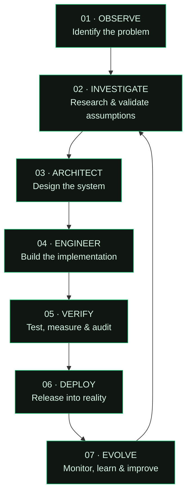

<!--
  TEMPLE LABS
  Organization profile README
  Repository: .github/profile/README.md
-->

# T E M P L E&nbsp; L A B S

### FORGE / ADVANCING HUMANITY.

**WE DON'T JUST BUILD SOFTWARE. WE EXPLORE WHAT SOFTWARE CAN BECOME.**

[ EXPLORE THE LAB ](#-explore-the-lab) &nbsp;·&nbsp;
[ OUR SYSTEMS ](#-selected-engineering) &nbsp;·&nbsp;
[ RESEARCH ](#-research--frontier) &nbsp;·&nbsp;
[ COLLABORATE ](#-open-the-lab)

 

---

<b>⌘ &nbsp; LAB CONSOLE — NAVIGATION</b>

| Module | Destination | Description |
|:--|:--|:--|
| 00 | [Introduction](#-the-laboratory) | Who we are |
| 01 | [Disciplines](#-engineering-disciplines) | What we engineer |
| 02 | [Systems](#-selected-engineering) | Products and projects |
| 03 | [Frontier](#-research--frontier) | Experimental research |
| 04 | [Architecture](#-how-we-engineer) | How we build |
| 05 | [Technology](#-technology-matrix) | Our engineering toolkit |
| 06 | [Open Lab](#-open-the-lab) | Collaboration and open source |

# ◈ THE LABORATORY

We are an independent software engineering and technology research laboratory.

Temple Labs operates at the intersection of software engineering, applied intelligence, infrastructure and emerging technologies.

Our work spans the entire lifecycle of an idea: from initial research and experimentation to architecture, implementation, deployment and continuous improvement.

We are interested in difficult problems, unconventional approaches and systems that create measurable value.

**Our philosophy is simple:**

> Forge what doesn't exist. Improve what does. Advance what comes next.

---

# ⬡ ENGINEERING DISCIPLINES

<b>01 — ARTIFICIAL INTELLIGENCE & COMPUTATIONAL INTELLIGENCE</b>

We develop intelligent software that can interpret information, reason over context, automate workflows and interact with the world.

- AI-powered applications and agents
- LLM integrations and orchestration
- Computer vision and identity intelligence
- Applied machine learning
- Intelligent workflow automation
- Human-computer interaction

<b>02 — DISTRIBUTED SYSTEMS & COMPUTING</b>

We engineer the underlying systems that make modern software reliable, scalable and responsive.

- Distributed application architecture
- Event-driven systems
- Messaging and asynchronous processing
- Real-time communication
- High-performance backend engineering
- Experimental computing architectures

<b>03 — CLOUD, INFRASTRUCTURE & DEVOPS</b>

Software must survive beyond the development environment.

- Cloud-native architecture
- Containerization and orchestration
- Infrastructure automation
- CI/CD pipelines
- Observability and telemetry
- Deployment and operational reliability

<b>04 — SECURITY & DIGITAL TRUST</b>

We explore technologies that help establish trust in increasingly digital environments.

- Identity verification
- Impersonation detection
- Application security
- Secure system architecture
- Privacy-conscious engineering
- Threat-aware automation

<b>05 — BLOCKCHAIN & WEB3</b>

We experiment with decentralized systems and the infrastructure surrounding digital ownership and coordination.

- Smart contract integrations
- Wallet infrastructure
- Token ecosystems
- Decentralized applications
- On-chain data integration

<b>06 — CONNECTED SYSTEMS & IOT</b>

Connecting computation with the physical world.

- Device communication
- Sensor networks
- Telemetry and monitoring
- Intelligent automation
- Industrial and environmental applications

---

# ⬢ SELECTED ENGINEERING

Not everything we build belongs to the same category. Some projects are products. Others are experiments, infrastructure or explorations into entirely different computing paradigms.

<b>01 / JARKATA — DIGITAL IDENTITY INTELLIGENCE</b> · Expand dossier

**The problem:** Seeing someone on a video call does not necessarily establish that they are who they claim to be.

Jarkata explores real-time detection of video-call impersonation across modern communication platforms.

The broader vision is to make identity verification an intelligent layer of digital communication.

**Application domains**

- Recruitment and remote interviews
- Enterprise security
- Social and online interactions
- Digital identity protection

**Engineering focus**

`AI` `Computer Vision` `WebRTC` `Browser Extensions` `Real-time Processing`

<b>02 / NFM26 — FOOTBALL SIMULATION & MANAGEMENT</b> · Expand dossier

A football management simulation built around the depth, character and possibilities of Nigerian football.

NFM26 explores the intersection of sports management, simulation engineering and interactive game systems.

**Systems**

- Tactical formation and match management
- Player development and progression
- 2D match simulation
- Football club management
- Competition and league systems
- Multilingual player experiences

**Engineering focus**

`Simulation` `Game Systems` `AI` `Frontend Engineering` `Data Modelling`

<b>03 / SQWAD — DECENTRALIZED DIGITAL ECOSYSTEMS</b> · Expand dossier

An exploration of Web3 infrastructure, digital communities and token-powered engagement.

SQWAD brings together discovery, profiles, digital participation and blockchain integrations.

**Systems**

- Token ecosystem infrastructure
- Wallet connectivity
- Digital profiles and directories
- Community engagement
- Referral and rewards mechanisms

**Engineering focus**

`Blockchain` `Web3` `Smart Contracts` `Next.js` `Wallet Infrastructure`

<b>04 / PROTON-X — ALTERNATIVE COMPUTING RESEARCH</b> · Expand dossier

**What if the fundamental assumptions behind electronic computing could be challenged?**

Proton-X is an experimental computing concept exploring the possibility of using protons rather than electrons as information carriers in computing systems.

It opens questions around alternative charge transport, physical computing architectures, material constraints and the feasibility of proton-based computational mechanisms.

This is a research direction, not a claim of a functioning proton-based processor.

**Research dimensions**

- Proton transport and charge behaviour
- Alternative computational architectures
- Physical and material constraints
- Information representation
- Theoretical feasibility and engineering challenges

**Research domain**

`Computational Physics` `Advanced Computing` `Systems Research` `Experimental Architecture`

---

# ⌘ RESEARCH & FRONTIER

We believe the most interesting engineering questions often exist beyond established product categories.

Our research interests include:

| Frontier | Question |
|:--|:--|
| Alternative computing | Can computation be approached through different physical mechanisms? |
| Applied intelligence | How can AI become a dependable component of real-world systems? |
| Digital identity | How can digital presence become more trustworthy? |
| Distributed infrastructure | How can complex systems remain resilient under unpredictable conditions? |
| Human-machine interaction | How should people interact with increasingly intelligent systems? |
| Connected environments | How can software meaningfully interact with physical infrastructure? |

Research is not a marketing label. It means asking questions, investigating assumptions and distinguishing demonstrated results from theoretical possibilities.

---

# ⌬ HOW WE ENGINEER

We approach engineering as a continuous process rather than a sequence of disconnected coding tasks.

### Our engineering principles

- **First principles:** Understand why a system works before deciding how to build it.
- **Precision:** Prefer measurable engineering over impressive-sounding claims.
- **Resilience:** Design for failures, unexpected conditions and imperfect environments.
- **Simplicity:** Reduce complexity without sacrificing capability.
- **Iteration:** Build, validate, learn and improve.
- **Curiosity:** Never confuse today's technical limitations with the boundaries of tomorrow.

---

# ⬡ TECHNOLOGY MATRIX

Our stack is selected according to the problem, not the other way around.

<b>LANGUAGES & RUNTIMES</b>

`Go` · `TypeScript` · `JavaScript` · `Python` · `Rust` · `C#`

<b>APPLICATION ENGINEERING</b>

`React` · `Next.js` · `Node.js` · `NestJS` · `React Native` · `.NET` · `Rails`

<b>DATA & MESSAGING</b>

`PostgreSQL` · `MongoDB` · `Redis` · `NATS` · `Kafka`

<b>INFRASTRUCTURE & OPERATIONS</b>

`Linux` · `Docker` · `Kubernetes` · `AWS` · `Terraform` · `GitHub Actions` · `OpenTelemetry`

<b>REAL-TIME & CONNECTIVITY</b>

`WebSockets` · `WebRTC` · `WebTransport` · `REST APIs` · `Event-Driven Architecture`

---

# ◈ OPEN THE LAB

We welcome thoughtful collaboration with engineers, researchers, designers, founders and open-source contributors.

We are particularly interested in:

- Engineers who enjoy solving difficult technical problems.
- Researchers exploring emerging computing paradigms.
- Developers building useful open-source infrastructure.
- People interested in AI, distributed systems and intelligent automation.
- Collaborators who value execution, technical integrity and experimentation.

**Interested in building something together?**

[Explore Temple Labs repositories →](https://github.com/tlabsxten?tab=repositories)

[Open a discussion →](https://github.com/tlabsxten/.github/discussions)

[Explore open issues →](https://github.com/tlabsxten?tab=issues)

---

# THE FUTURE IS NOT A SPECTATOR SPORT.

### WE FORGE IT.

 

**T E M P L E &nbsp; L A B S**

*Forge / advancing humanity.*

INDEPENDENT THINKING. PRECISE ENGINEERING. UNFINISHED FRONTIERS.

